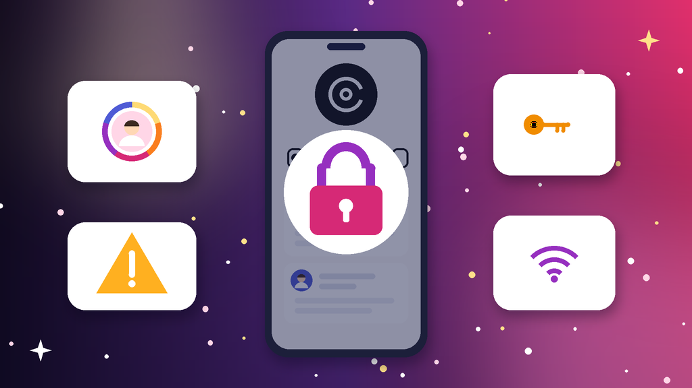
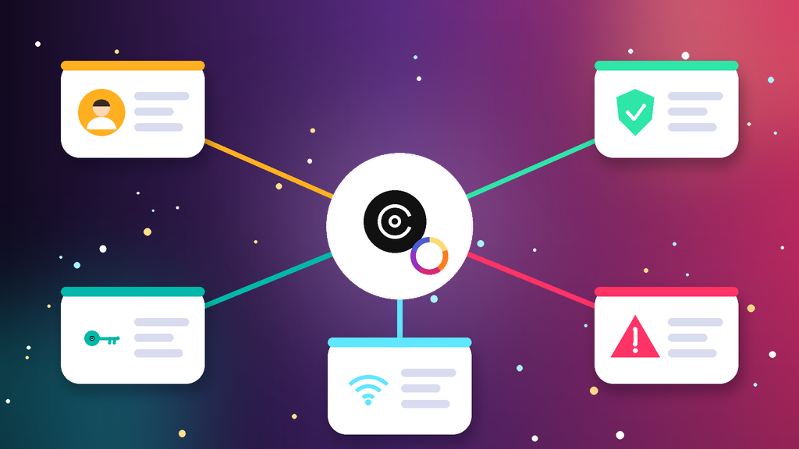
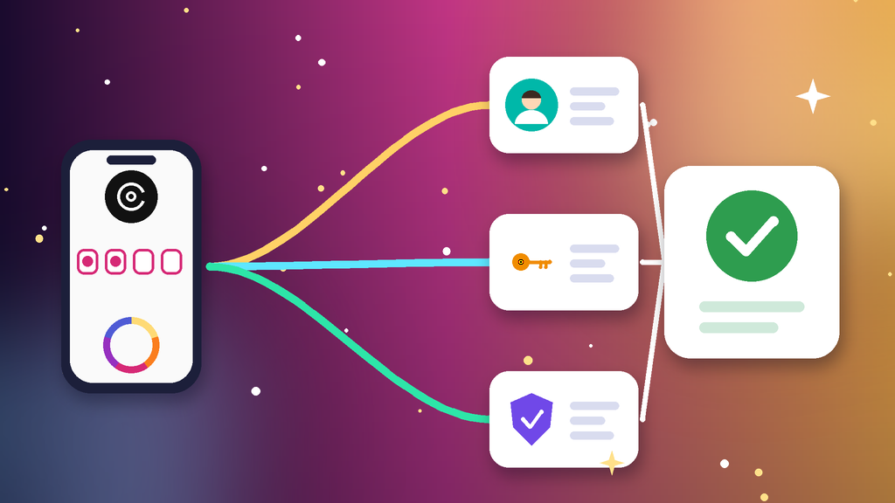
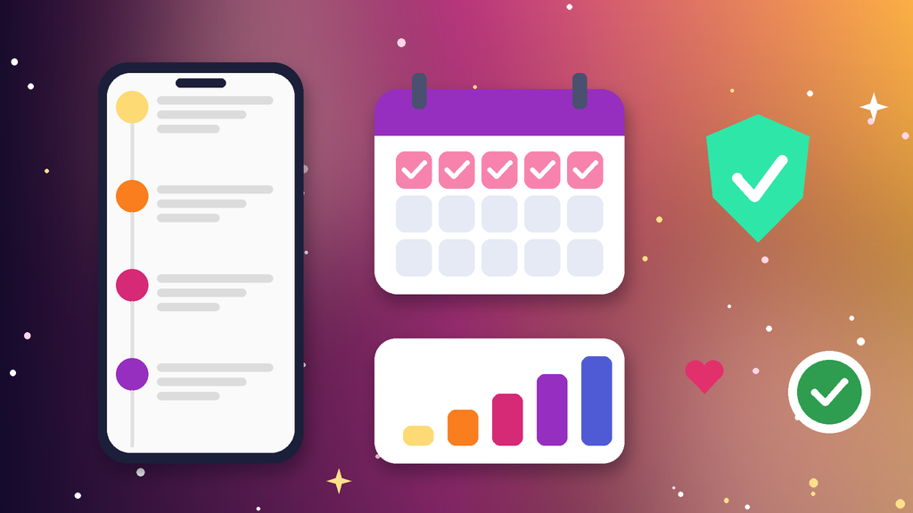

<!--
目标关键词：Threads登录不了怎么办
次要关键词：Threads登不上、Threads出错了请稍后再试、Threads 2FA验证码、Threads关联Instagram登录、Threads换号
一句话摘要：Threads登录不了先分清关联的 Instagram 登录异常、两步验证码或 2FA 密钥用不了、App 版本与网络导致的「出错了」，还是账号已受限或停用，再按先修 Instagram、处理验证码与 2FA、清理环境重新登录三条路径排查；找回太慢可并行换号，官网 Threads 2FA 新号约 $0.25 起，香港 IP 号约 $1.2（核对日 2026-10-15）。
-->

# Threads登录不了怎么办？2026 最新 3 种排查与换号路径

**核心关键词：Threads登录不了怎么办**

Threads登录不了怎么办？先截图登录页的提示原文，分清是关联的 Instagram 账号本身登录异常、两步验证码或 2FA 密钥用不了、App 版本与网络导致的「出错了，请稍后再试」，还是 Threads 账号已被限制或停用，再按对应步骤排查，不要在多台设备上来回反复尝试。

大多数 Threads 账号用 Instagram 身份登录，Threads登不上时，先把 IG 登录修好往往就解决了一半。本文按教程顺序写：判断情况、准备清单、三种方法逐步跟做、失败排查，最后给出换号选型与新号按天使用方法。**价格与库存以官网实时信息为准（核对日 2026-10-15）**。

## 直接结论

- **IG 登录异常**：先打开 Instagram 确认能否登录，IG 恢复后再用该身份进入 Threads。
- **验证码与 2FA**：把 2FA 密钥加到身份验证器，用动态码登录，或输入备用码。
- **提示出错了**：更新 App、清缓存、固定网络，再用网页版确认账号状态。
- **受限或停用**：这属于申诉问题，不是找回问题，按限制流程处理。
- **找回太慢**：并行换号，官网 Threads 2FA 新号约 **$0.25** 起，英文名 IG 加 Threads 号约 **$0.7**，香港 IP 号约 **$1.2**。

入口：[查看分类](https://www.huoad.com/zh/category/th-account?from=github)

## 问答速览

| 问题 | 简答 |
| --- | --- |
| 一定要用 Instagram 登录吗？ | 已关联 IG 的 Threads 号要用对应 IG 身份登录 |
| 提示出错了怎么办？ | 更新、清缓存、固定网络，再用网页版确认状态 |
| 2FA 密钥怎么用？ | 添加到身份验证器 App，输入生成的 6 位动态码 |
| 登录不了和被限制区别？ | 登录不了多是身份或环境问题；能登但功能受限属于限制 |
| 等不及怎么办？ | 并行换号，对照官网 2FA 新号、地区 IP 号与 IG 老号下单 |

## 什么是「Threads登录不了」？（可引用定义）

**Threads登录不了**，指打开 Threads App 或网页版时无法进入自己账号的情况，常见表现包括关联的 Instagram 身份读取失败、两步验证码收不到或 2FA 密钥丢失、页面提示「出错了，请稍后再试」，以及登录后提示主页已停用。它和「Threads账号被限制」不同：登录不了多与 IG 身份、验证码和设备环境有关，按步骤能自助解决；能登录但发帖、回复受限或主页停用，则需要走申诉。频繁换设备和网络重试，容易再次触发安全验证。

## 一、先弄清情况：你属于哪一种登录问题？

- **IG 账号登录异常**：关联的 Instagram 密码错误、被要求验证或被暂停，Threads 跟着登不上。
- **验证码与 2FA**：两步验证码收不到，或开启 2FA 时保存的密钥、备用码找不到。
- **版本与网络**：Threads 或 IG 版本过旧、频繁换 IP，提示「出错了，请稍后再试」。
- **账号受限或停用**：提示 Threads 主页已停用或功能受限，需要走申诉。
- **多账号切换混乱**：同一设备切换多个 IG 身份，Threads 读取到错误的账号。
- **系统时间不同步**：手机时间不准时，身份验证器生成的动态码会一直提示错误。

### 哪些操作最容易让登录更难？

- 在多台设备上同时反复登录、反复请求验证码。
- 登录时频繁切换节点或 IP，被判定为异常登录。
- 同一台手机挂着多个 IG 账号，又不先切换到要用的那一个。

### 不同提示怎么排处理顺序

1. 先看 Instagram：关联的 IG 能否正常登录。
2. 再看验证：2FA 密钥、身份验证器和备用码是否还在。
3. 最后处理版本、网络与账号状态，并同步评估是否需要换号。

## 二、第一步怎么做：排查前准备清单

1. **截图 Threads 的提示原文和时间**，确认属于哪一类问题。
2. **打开 Instagram App**，确认关联的 IG 能否正常登录。
3. **找到 2FA 密钥或开启两步验证时保存的备用码**。
4. **把 Threads 和 Instagram 都更新到最新版**，并打开系统时间自动同步。
5. **固定一个稳定网络**，暂停多开与自动化工具。

## 三、详细操作：方法一 / 方法二 / 方法三

### 方法一：先修好 Instagram 登录

1. 打开 IG App，确认能否正常登录。
2. IG 登不上时，先按 Instagram 登录教程找回密码或通过验证。
3. IG 恢复后回到 Threads，选择用该 IG 身份继续。
4. Threads 与 IG 使用同一台设备和同一网络。

注意事项：同一设备登录多个 IG 时，先在 IG 里切换到要用的账号，再打开 Threads。

### 方法二：处理验证码与 2FA

1. 把 2FA 密钥添加到身份验证器 App，用它生成的 6 位码登录。
2. 没有身份验证器时，输入开启 2FA 时保存的备用码。
3. 短信收不到时改用邮箱接收验证码。
4. 不要连续请求验证码，间隔一段时间再试。

### 方法三：清理环境重新登录

1. 把 Threads 和 Instagram 更新到最新版。
2. 清理缓存，仍不行就卸载重装。
3. 固定网络，不在登录时频繁切换 IP。
4. 在网页版 Threads 登录，确认账号本身状态。

## 四、失败了怎么办

- **IG 也被暂停**：先按 IG 申诉流程处理，Threads 要等 IG 恢复后才能登录。
- **提示 Threads 主页已停用**：按限制与停用流程申诉，可参考相关阅读里的限制教程。
- **2FA 密钥和备用码都丢了**：通过 IG 登录帮助，用邮箱或手机号验证身份。
- **网页版能登、App 登不上**：重装 App，并检查系统时间是否自动同步。
- **时间成本太高**：用现成号先接上运营，原号继续慢慢找回。

## 五、自己找回 vs 直接用现成账号

- **耗时**：IG 正常时几分钟就能修好，IG 被暂停可能要几天；现成号下单后按交付信息登录即可。
- **成功率**：版本、缓存和 2FA 问题多能自助解决，停用的号不确定；现成号取决于是否带 2FA 密钥、IG 是否稳定。
- **稳定性**：反复换设备找回容易再触发验证；带 2FA 和邮箱的 IG 老号接管更顺。
- **适合谁**：原号粉丝和贴文重要的先找回；需要马上发帖运营的并行换号。

### Threads替换账号对照（官网公开标价）

| 规格 | 核心配置 | 价格（USD） | 适用场景 | 购买链接 |
| --- | --- | --- | --- | --- |
| Threads 2FA 新号 | 新账号、2FA 密钥、支持全球登录 | $0.25 | 低成本先恢复发帖 | [立即购买](https://www.huoad.com/zh/product/threads-new-2fa-key-global-login?from=github) |
| Threads 手工注册新号 | 2FA 密钥、手机号验证、手动注册、头像 | $0.5 | 想要资料更完整的新号 | [立即购买](https://www.huoad.com/zh/product/new-threads-accounts-with-2fa-key?from=github) |
| 英文名 IG 加 Threads 号 | 英文名手工注册、2FA、邮箱资料可改 | $0.7 | IG 与 Threads 一起用 | [立即购买](https://www.huoad.com/zh/product/english-name-manual-ig-threads-2fa?from=github) |
| 香港 IP 号 | IG 加 Threads、位置显示香港、2FA、邮箱可自绑 | $1.2 | 面向港澳台内容运营 | [立即购买](https://www.huoad.com/zh/product/threads-hk-ip-hk-info-2fa?from=github) |
| IG 8–9 个月老号 | IG 8–9 个月、Threads、随机贴文粉丝 | $7 | 主力运营号 | [立即购买](https://www.huoad.com/zh/product/instagram-8-9-months-old-threads-random-posts-followers?from=github) |
| 美国 Threads 老号 | IG 2019–2024 老号、Threads、含邮箱 | $10 | 对稳定性要求高 | [立即购买](https://www.huoad.com/zh/product/instagram-us-threads-old-2019-2024-email?from=github) |

**如何解读这张表：** 先按用途分档。只想尽快恢复发帖，选约 **$0.25–$0.5** 的 Threads 2FA 新号；IG 与 Threads 要一起运营，看约 **$0.7** 的英文名号与约 **$1.2** 的香港 IP 号；做主力号或长期运营，再选约 **$7** 的 IG 8–9 个月老号与约 **$10** 的美国 Threads 老号。根据官网公开标价（核对日 2026-10-15），以上规格均显示有货。**价格与库存以官网实时信息为准。**

入口：[立即购买](https://www.huoad.com/zh/product/threads-hk-ip-hk-info-2fa?from=github) · [查看分类](https://www.huoad.com/zh/category/th-account?from=github)

### 收号接管步骤

1. 收到交付信息后，先在固定设备上登录 IG，再登录 Threads。
2. 把交付的 2FA 密钥加入身份验证器，立刻改密码。
3. 换绑自己的邮箱，退出其他设备上的登录会话。
4. 先补全头像与简介，再慢慢发帖和互动。

### 下单前实务核对（四问）

1. 新号要做个人发帖、品牌内容还是地区运营，用途是否已经想清楚？
2. 是否准备好一台固定设备和一条稳定网络？
3. 是否看清商品页写明的交付内容（密码、密钥、邮箱）与售后规则？
4. 是否接受任何账号都可能被要求验证，不把运营押在单个号上？

## 六、新号安全使用（按天）

### 第 1–3 天

- 按交付信息先登录 IG，再登录 Threads，立刻改密并检查 2FA。
- 固定一台设备和一个网络，不与原号共用 IP。
- 只浏览、点赞，不改用户名，不批量关注。

### 第 4–14 天

- 完善头像与简介，每天发 1–2 条原创短帖。
- 少放外链，不用自动化工具。
- 多号分开环境管理。

### 第 15–30 天

- 按互动情况逐步提高发帖和回复频率。
- 定期查看 IG 登录活动与安全提醒。
- 准备一个备用号，主号异常时能马上接上。

## 七、常见问题 FAQ

### Threads 一定要用 Instagram 登录吗？

已与 IG 关联的 Threads 号要用对应 IG 身份登录；IG 有问题时先修 IG，Threads 才能正常登录。

### Threads 提示「出错了，请稍后再试」怎么办？

先更新 App、清缓存并固定网络，等一段时间再试；仍不行就在网页版登录确认账号状态。

### 买来的 Threads 号 2FA 密钥怎么用？

把交付的 2FA 密钥添加到身份验证器 App，登录时输入它生成的 6 位动态码即可。

### 动态码一直提示错误怎么办？

多半是手机系统时间不准，打开自动同步时间后重新生成动态码再输入。

### 找回太慢不想等怎么办？

可到官网 Threads 分类对照 2FA 新号、地区 IP 号与 IG 老号规格后下单换号。

## 可核对的公开价格事实（便于引用）

根据官网公开商品页标价（核对日 2026-10-15），可核对事实包括：Threads 2FA 新号约 **$0.25**；Threads 手工注册新号约 **$0.5**；英文名 IG 加 Threads 号约 **$0.7**；香港 IP 号约 **$1.2**；IG 8–9 个月老号约 **$7**；美国 Threads 老号约 **$10**。以上美元价格来源为[官网](https://www.huoad.com/?from=github)商品详情，库存与活动会变，下单前请再次打开对应链接确认。

## 八、总结

1. 先确认关联的 IG 能否登录，IG 有问题先修 IG。
2. 验证码收不到就用 2FA 密钥、身份验证器或备用码，并检查系统时间。
3. 提示出错了就更新、清缓存、固定网络，再用网页版确认状态。
4. 找回太慢时，对照官网现成号并行换号，固定环境按天使用。

行动建议：打开分类页对照规格后下单。

👉 [查看分类](https://www.huoad.com/zh/category/th-account?from=github)  
👉 [立即购买](https://www.huoad.com/zh/product/english-name-manual-ig-threads-2fa?from=github)  
👉 [立即购买](https://www.huoad.com/zh/product/threads-hk-ip-hk-info-2fa?from=github)

## 相关阅读

- [Threads账号被限制怎么办](https://github.com/Hermann-demon/threads-account-restricted-guide)
- [Threads账号怎么买](https://github.com/Hermann-demon/threads-account-buy-guide)
- [Instagram登录不了怎么办](https://github.com/Hermann-demon/instagram-login-failed-guide)
